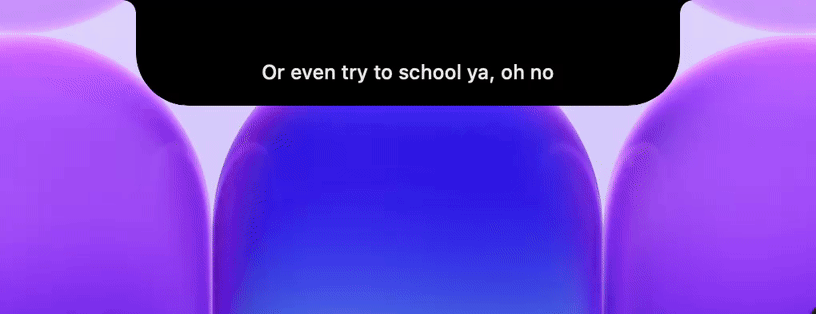
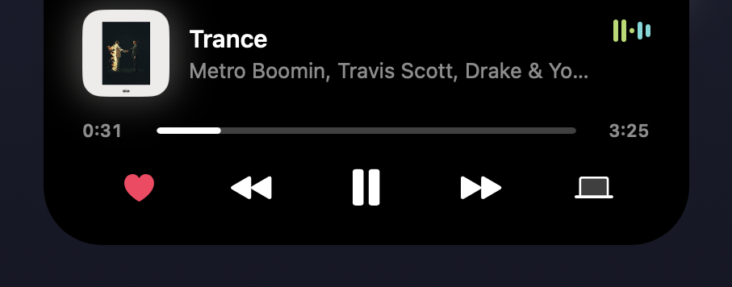
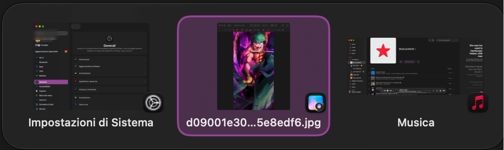
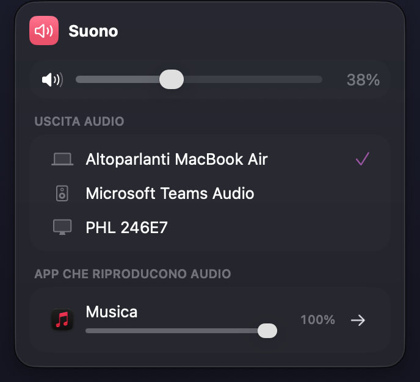
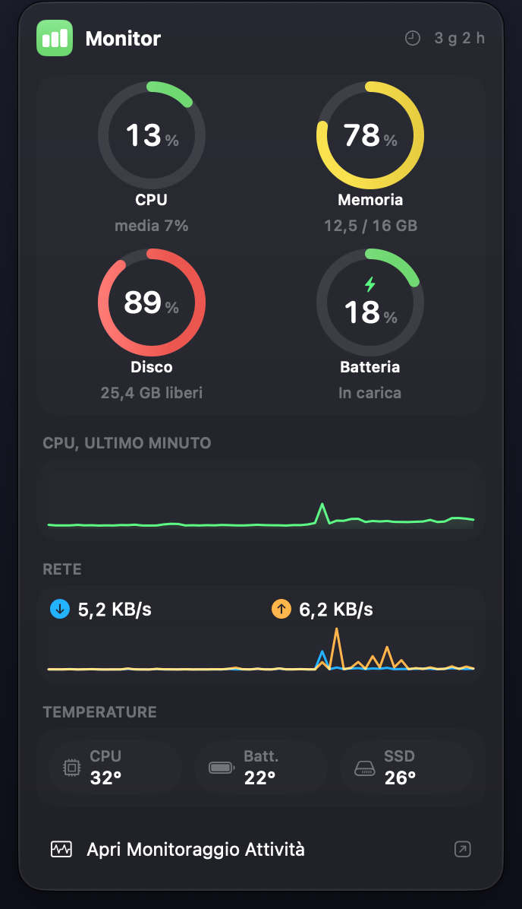
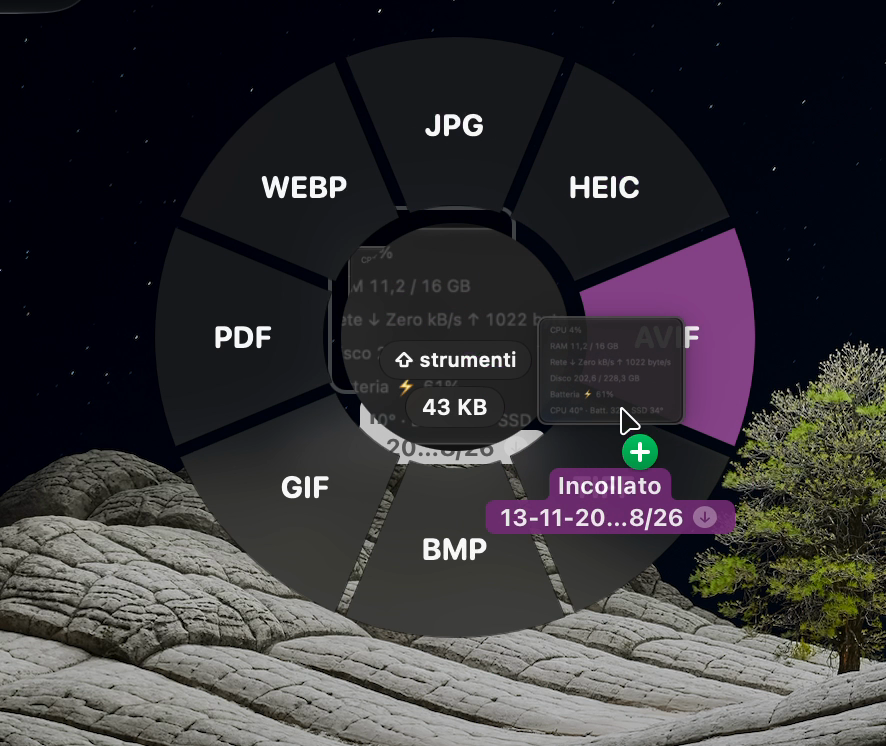
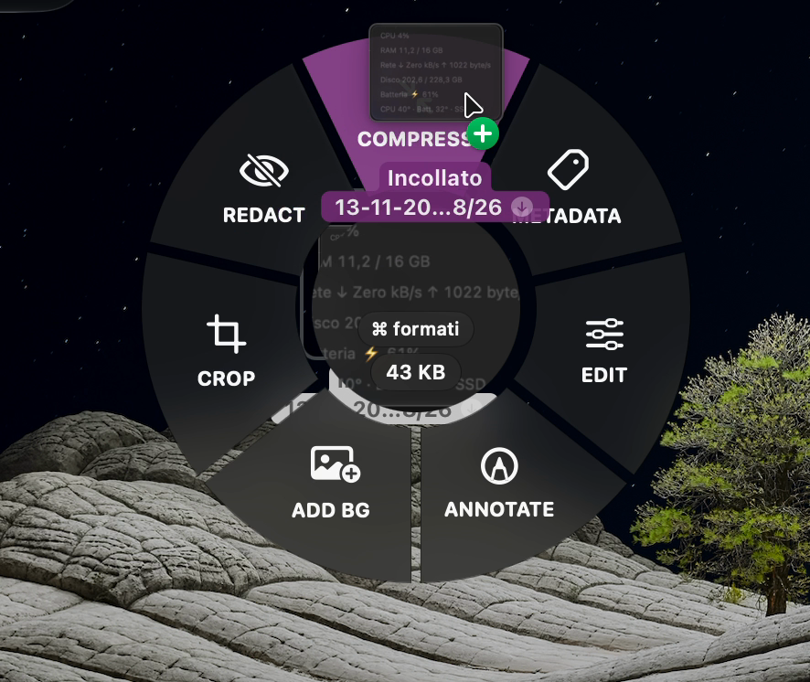
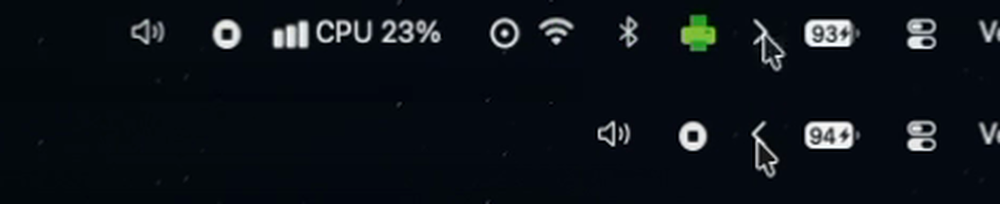

<p align="center">
  
</p>

<h1 align="center">Tsukumo</h1>

<p align="center">
  One app instead of twelve: a free, open-source, native macOS toolkit for Apple Silicon.
</p>

<p align="center">
  <a href="https://github.com/clackes/Tsukumo/releases/latest"></a>
  
  
  <a href="LICENSE"></a>
</p>

<p align="center">
  
</p>

Tsukumo puts the small utilities that usually take a dozen menu bar apps into a single native app: a Dynamic Island in the notch, window snapping, an Alt-Tab switcher, per-app volume, a system monitor and more. Every module turns on and off on its own, and **a module that is off runs no code, has no timers and no observers**. With every module off the app stays under 35 MB and does nothing in the background.

> **Early release.** It works, but it is not notarized by Apple yet (see [Install](#install)).

## Modules

| Module | What it does |
|---|---|
| **Island** | A Dynamic Island on the notch (or a pill on Macs without one): now playing with artwork and synced lyrics, battery, calendar with "Join", volume and brightness HUD, a shelf to drop files on (with AirDrop), and a lock screen player with lyrics and the artwork as background. |
| **Snap** | Snap windows to halves, quarters or full screen, with shortcuts or by dragging them to the screen edges, with a preview. |
| **Switcher** | Window switching with ⌥⇥ (or instead of ⌘⇥), with thumbnails and windows from every Space. |
| **MenuBar** | Hide and reorder menu bar icons, system ones included. |
| **Monitor** | CPU, memory, network, disk, battery and temperatures in the menu bar, sampled at a slow pace. |
| **Clack** | Mechanical keyboard sounds with Mechvibes packs, low latency, audio engine on only while you type. |
| **Sound** | Per-app volume and output, quick output switching, and a block for Music launching on its own. |
| **Convert** | Drag a file while holding ⌘ and pick the format on a wheel. Images, audio and video, plus tools (compress, crop, trim audio, bleep, remove background…). |
| **Duo** | The MacBook hinge open/close animation, driven by the lid angle sensor. |

**Not there yet:** Windeck (iPhone and iPad as a Stream Deck for the Mac) and the animated AirDrop in the Island shelf.

## Screenshots

<table>
  <tr>
    <td width="50%" align="center"><br><b>Island</b>: the player on the notch, with artwork, progress bar, favorite and controls.</td>
    <td width="50%" align="center"><br><b>Switcher</b>: ⌥⇥ shows windows with thumbnails, from other Spaces too.</td>
  </tr>
  <tr>
    <td align="center"><br><b>Sound</b>: volume, audio output and per-app volume, from the menu bar.</td>
    <td align="center"><br><b>Monitor</b>: CPU, memory, disk and battery, with last-minute graphs and temperatures.</td>
  </tr>
  <tr>
    <td colspan="2" align="center"> <br><b>Convert</b>: drag a file while holding ⌘ and pick the format on a wheel; add ⇧ for the tools wheel (compress, crop, metadata…).</td>
  </tr>
  <tr>
    <td align="center"><br><b>MenuBar</b>: hide and reorder menu bar icons, expanded above, collapsed below.</td>
    <td valign="top"><b>Clack</b>: your Mac keyboard sounds like a mechanical one, with Mechvibes packs.<br><br><b>Duo</b>: the foldable-phone animation, on the MacBook hinge.</td>
  </tr>
</table>

### Snap shortcuts

Snap has no window of its own: use the keyboard or drag a window to a screen edge (needs the Accessibility permission). Shortcuts can be changed in the module settings; the defaults are ⌃⌥ plus a key.

| Shortcut | Front window goes to |
|---|---|
| ⌃⌥ ← / → | Left / right half |
| ⌃⌥ ↑ / ↓ | Top / bottom half |
| ⌃⌥ U / I | Top-left / top-right quarter |
| ⌃⌥ J / K | Bottom-left / bottom-right quarter |
| ⌃⌥ ⏎ | Maximize (fills the usable area, menu bar and Dock stay visible) |
| ⌃⌥ C | Center, same size (shrinks it if larger than the screen) |
| ⌃⌥ ⌫ | Restore the position and size it had before snapping |

**Dragging** a window to a screen edge shows a preview of the zone; release to snap. Left or right edge: half. Top edge (middle): full screen. Corners (within 120 points of a corner): that quarter. On multiple displays, an edge shared with another screen does not snap, since the window is just moving across.

## Install

You need a Mac with **Apple Silicon** and **macOS 26 or later**.

1. Download the DMG from [Releases](https://github.com/clackes/Tsukumo/releases/latest).
2. Open it and drag **Tsukumo** to Applications.
3. The app is not notarized yet, so macOS blocks it the first time. To allow it, open Terminal and paste:

   ```sh
   xattr -dr com.apple.quarantine /Applications/Tsukumo.app
   ```

   Or: try to open it, then go to *System Settings → Privacy & Security* and click **Open Anyway**.
4. Open Tsukumo and follow the introduction: pick a preset, then grant permissions.

Permissions (Accessibility, Input Monitoring, Screen Recording) are asked **once, all together**, on the second page of the introduction: each row says what it is for and which modules use it. None is mandatory, and you can review them any time from *Settings → General → Review Permissions…*. To update, download the new version and replace the app.

## Energy and privacy

- **Zero telemetry.** The only network connections are the update check and, only if you turn on song lyrics, requests to [LRCLIB](https://lrclib.net).
- No timers outside the resource manager, events instead of polling, no global mouse-move monitor, audio engine on only when there is sound to play.
- *Settings → Energy* shows the app's real energy use.
- The full rules and per-module budgets are in [Docs/DESIGN.md](Docs/DESIGN.md), section 5.

## Build from source

Requirements: Xcode 26 or later (Swift 6), [XcodeGen](https://github.com/yonaskolb/XcodeGen).

```sh
git clone https://github.com/clackes/Tsukumo.git
cd Tsukumo/App
xcodegen generate
open Tsukumo.xcodeproj
```

Each module is a local Swift package in `Packages/Modules/<Name>/` with its own tests (`swift test` in that folder). `Tools/check.sh` runs lint, license checks, tests and the build, like CI. `Tools/make-dmg.sh` builds the DMG.

The architecture, energy budget, security model and roadmap are in [Docs/DESIGN.md](Docs/DESIGN.md).

## Contributing

Issues and pull requests are welcome. Please read [CONTRIBUTING.md](CONTRIBUTING.md) first: in short, keep the energy rules, add tests, and sign off your commits (DCO).

## Support

Tsukumo is free with no paywall. If it is useful to you, you can support it with [GitHub Sponsors](https://github.com/sponsors/clackes) (also linked in *Settings → General*).

## License

Tsukumo is free software, licensed under the [GNU General Public License v3.0 only](LICENSE). Every file carries an SPDX header; license texts are in [LICENSES/](LICENSES).

Third-party components keep their own licenses: ffmpeg (LGPL, Convert's optional engine), MIT code adapted in Duo, and mediaremote-adapter (BSD-3-Clause). Details in [THIRD-PARTY-NOTICES.md](THIRD-PARTY-NOTICES.md).
